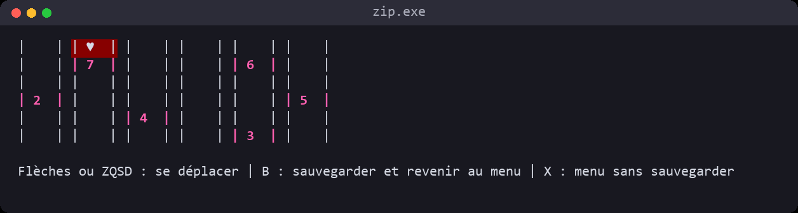
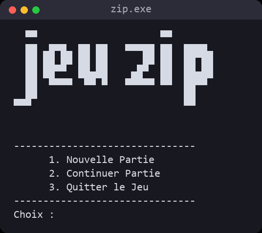
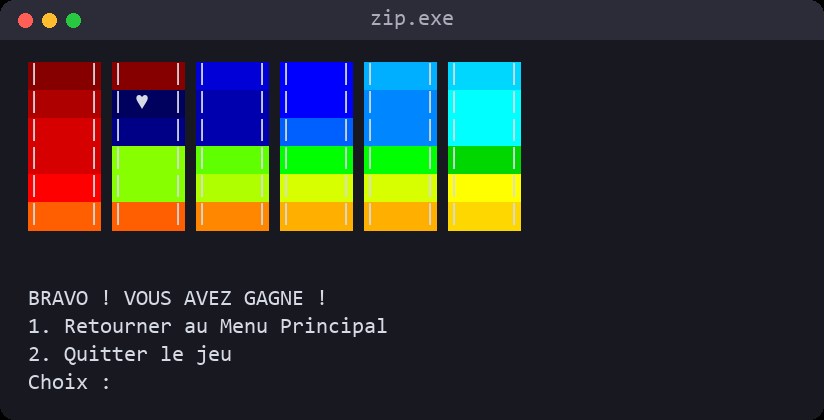
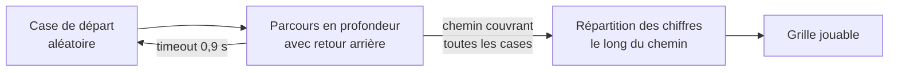

<div align="center">

# ZIP — jeu de parcours logique en C

**Tracez un chemin unique qui couvre toute la grille en reliant les chiffres dans l'ordre.**
Grilles générées procéduralement, rendu couleur en console, sauvegarde de partie.

[](https://github.com/e1000ouch/zip-puzzle/actions/workflows/build.yml)
[](https://github.com/e1000ouch/zip-puzzle/releases/latest)




</div>

---

## Jouer tout de suite

1. Téléchargez **`ZIP-windows-x64.zip`** depuis la [dernière release](https://github.com/e1000ouch/zip-puzzle/releases/latest).
2. Décompressez puis double-cliquez sur **`zip.exe`**. Aucune installation (Windows 10 / 11).

> Windows SmartScreen peut signaler un exécutable non signé : *Informations complémentaires* → *Exécuter quand même*.

## Règles

| | Règle |
|---|---|
| 🟩 | Passer **une et une seule fois** par chaque case de la grille |
| 🔢 | Atteindre les chiffres **dans l'ordre** (1 → 2 → 3 …) et **terminer sur le dernier** |
| ➕ | Se déplacer horizontalement ou verticalement, **jamais en diagonale** |
| ↩️ | Revenir sur ses pas **efface** le chemin, case par case |

### Commandes

| Touche | Action |
|---|---|
| `↑` `↓` `←` `→` ou `Z` `Q` `S` `D` | Tracer le chemin |
| `B` | Sauvegarder et revenir au menu |
| `X` | Revenir au menu sans sauvegarder |

<p align="center">
  
  &nbsp;
  
</p>

## Fonctionnalités

- **Génération procédurale** : chaque grille (5×5 à 10×10, 2 à 12 chiffres) est construite autour d'un chemin hamiltonien, donc **toujours soluble**.
- **Rendu console soigné** : dégradé de couleurs ANSI 256 qui matérialise la progression, redessin sans clignotement (`SetConsoleCursorPosition`).
- **Retour arrière** : le joueur peut rebrousser chemin, le compteur de chiffres suit.
- **Sauvegarde / chargement** dans un fichier texte, avec validation des données relues.
- **Tests automatisés** de la logique et **intégration continue** (GitHub Actions) qui compile en `-Wall -Wextra -Werror`, lance les tests et publie l'exécutable.

## Comment la grille est générée



1. **Chemin hamiltonien.** Un parcours en profondeur récursif (backtracking) cherche un chemin qui visite chaque case exactement une fois.
   À chaque étape, les directions sont **mélangées aléatoirement** puis triées selon l'**heuristique de Warnsdorff** : on explore d'abord la case qui a le moins d'issues, ce qui évite de s'enfermer.
   Résultat : un chemin différent à chaque partie, trouvé quasi instantanément même en 10×10 (un timeout relance la recherche dans le pire cas).
2. **Contrainte de parité.** Sur une grille de taille impaire, un chemin hamiltonien ne peut partir que d'une case « noire » d'un damier (`(x + y)` pair). Le départ est tiré en conséquence.
3. **Placement des chiffres.** Le `1` est posé au début du chemin, le dernier chiffre à la fin, les autres régulièrement espacés avec une variation aléatoire de ±20 %.

## Architecture

```
zip-puzzle/
├── include/
│   ├── grille.h         # structures Case / Grille / Position, constantes, prototypes
│   ├── sauvegarde.h
│   └── console.h
├── src/
│   ├── main.c           # menu, configuration d'une partie, boucle de jeu
│   ├── generation.c     # chemin hamiltonien + placement des chiffres
│   ├── deplacement.c    # règles de déplacement et retour arrière
│   ├── victoire.c       # condition de victoire
│   ├── grille.c         # initialisation et rendu couleur de la grille
│   ├── sauvegarde.c     # lecture / écriture de sauvegarde.txt
│   └── console.c        # API console Windows (UTF-8, ANSI, curseur)
├── tests/
│   └── test_logique.c   # tests de la logique, sans interface
├── docs/                # captures, notes de release
├── Makefile
└── .github/workflows/   # CI : build, tests, release
```

Chaque case stocke deux informations : `numero`, l'ordre de passage du joueur (0 = libre), et `chiffre`, l'objectif imposé (0 = aucun).
Le retour arrière se résume alors à une règle simple : on ne peut revenir que sur la case de `numero` immédiatement inférieur, que l'on remet à 0.

## Compiler depuis les sources

Prérequis : Windows et GCC (par exemple [MSYS2](https://www.msys2.org/) UCRT64 : `pacman -S mingw-w64-ucrt-x86_64-gcc make`).

```bash
make          # produit zip.exe
make test     # lance les tests de la logique
make run      # compile et lance le jeu
```

Sans `make` : `gcc -std=c11 -O2 -Iinclude src/*.c -o zip.exe`

## Équipe

Projet réalisé en équipe de cinq dans le cadre d'une **SAE de première année de BUT Informatique** (semestre 1, 2025-2026).

| Membre | Contributions principales |
|---|---|
| **Emilien Brando** | Sauvegarde / chargement, règles de déplacement, intégration et menu, refonte du dépôt |
| **Anouk Ober** | Génération des grilles (chemin hamiltonien), rendu couleur, condition de victoire |
| **Yanis Benmira** | Sauvegarde / chargement, création du dépôt |
| **Noah Delattre** | Structures de données, initialisation de la grille, premier menu |
| **London Osseti-Fort** | Interface et affichage de la grille |

Dépôt d'origine : [yvnis22/Projet-ZIP](https://github.com/yvnis22/Projet-ZIP). L'historique Git complet de l'équipe est conservé ici.
